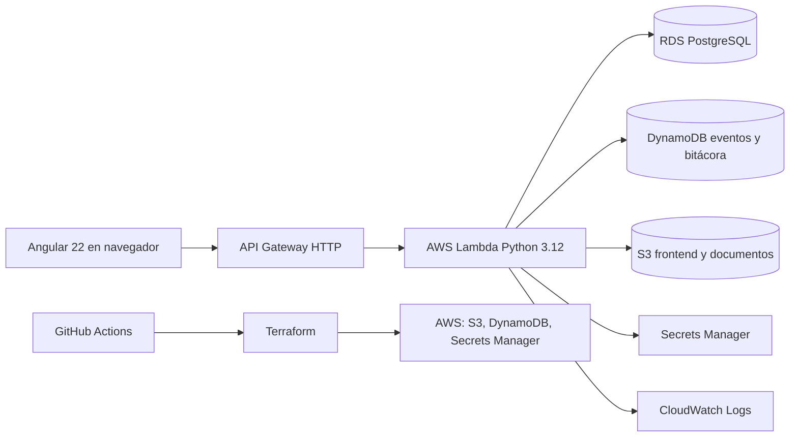

# Arquitectura de MiDoc

## Servicios y propósito

| Servicio | Propósito |
| --- | --- |
| API Gateway | Entrada HTTPS para el frontend y enrutamiento hacia Lambda. |
| AWS Lambda | Lógica de backend serverless y ejecución de los tres flujos con Python 3.12. |
| RDS PostgreSQL | Usuarios, perfiles, citas, consentimientos, recetas y suscripciones. |
| DynamoDB | Eventos y bitácora complementaria; no sustituye la base relacional principal. |
| S3 | Documentos médicos cifrados y archivos estáticos del frontend. |
| Secrets Manager | JWT secret y credenciales sin exponerlas en GitHub. |
| IAM | Permisos mínimos para despliegue y ejecución. |
| CloudWatch | Logs e instrumentación inicial; métricas, alertas y dashboard se completan en fase final. |

En local el backend usa memoria sólo para el demo y pruebas. Terraform empaqueta el handler Python, crea API Gateway, RDS PostgreSQL, grupos de seguridad, Lambda dentro de la VPC y un endpoint privado de Secrets Manager. `enable_rds` está activo por defecto. Los recursos temporales del laboratorio se destruyen después de las pruebas; se pueden reconstruir con `terraform apply`.
