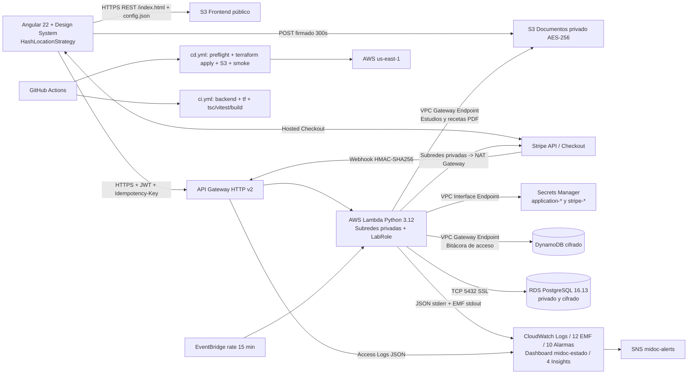

# Arquitectura de MiDoc (Fase 3)

## Componentes y persistencia

| Servicio / Módulo | Función en Fase 3 |
| --- | --- |
| **AWS Lambda (`midoc-api`)** | Ejecuta la API Python 3.12 y el trabajo programado de recordatorios dentro de dos subredes privadas (`172.31.96.0/20` en `us-east-1a`, `172.31.112.0/20` en `us-east-1b`) usando el rol existente `LabRole`. |
| **NAT Gateway + EIP** | Controlado por `enable_nat_gateway = true`. Permite salida HTTPS desde las subredes privadas de Lambda hacia `https://api.stripe.com/v1/*` sin exponer Lambda ni RDS a tráfico entrante. |
| **API Gateway HTTP v2** | Expone las rutas HTTPS, aplica CORS y escribe logs JSON de acceso (13 campos) hacia `/aws/apigateway/${project}-http-api`. |
| **RDS PostgreSQL 16.13** | Fuente de verdad transaccional (`PubliclyAccessible=false`, cifrado, `sslmode=require`), accesible sólo desde el security group de Lambda. Esquema gestionado en `backend/src/schema.sql` y migraciones `001`–`004`. |
| **Secrets Manager** | Dos secretos con `recovery_window_in_days = 0`: `${project}-application-*` (`jwt_secret`) y `${project}-stripe-*` (`payment_mode`, `stripe_secret_key`, `stripe_webhook_secret`, `price_amount_cents`, sin `ignore_changes` para alternar `test`/`live` en `apply`), más el secreto administrado de RDS. |
| **S3 Frontend** | Publica el bundle Angular 22 (`HashLocationStrategy`) y `config.json` (`{"apiUrl", "paymentMode"}`) mediante el endpoint REST HTTPS `/index.html`, sin necesitar CloudFront. |
| **S3 Documentos** | Bucket separado, privado, cifrado AES-256 y con bloqueo público. Almacena estudios clínicos subidos por pacientes (POST/GET firmados por 300 s) y **PDFs reales de recetas médicas** (`recetas/{receta_id}.pdf` generados por `backend/src/pdf_receta.py`). |
| **DynamoDB** | Tabla `PAY_PER_REQUEST` cifrada para bitácora complementaria e inmutable de acceso a expedientes (`pk=PACIENTE#<id>`, `sk=ACCESO#<fecha>#<uuid>`), tolerante a fallos en lectura desde `/api/records/access-log`. |
| **EventBridge** | Regla `midoc-reminders` (`rate(15 minutes)`) que invoca Lambda con `{"source": "midoc.reminders"}` para generar avisos de citas en 24 h y vencimientos de suscripción en 7 días. |
| **CloudWatch + SNS** | 2 Log Groups con retención de 14 días, logs JSON con redacción de PII/secretos, **12 métricas EMF** en namespace `MiDoc`, **10 alarmas** (aplicación, Lambda, API GW y RDS), tópico **SNS** (`midoc-alerts` + correo opcional), **4 consultas Logs Insights** y dashboard `midoc-estado`. Ver [OBSERVABILIDAD-Y-CICD.md](OBSERVABILIDAD-Y-CICD.md). |
| **IAM (`LabRole`)** | Se conserva el rol existente de AWS Academy sin crear roles ni modificar políticas globales. |
| **GitHub Actions** | `ci.yml` valida pruebas backend, Terraform y frontend en cada push/PR; `cd.yml` ejecuta `preflight`, `terraform apply`, publicación frontend y smoke checks en `main` o `workflow_dispatch`. |

## Flujos principales y controles de acceso

1. **Búsqueda y agenda:** El paciente filtra profesionales por especialidad, ubicación, texto y ordenamiento (`NAME`, `PRICE_ASC`, `PRICE_DESC`, `AVAILABILITY`). Sólo doctores/clínicas con suscripción activa aparecen en el directorio. Las reservas validan ventana de 90 días, unicidad en PostgreSQL (`ux_cita_doctor_horario`) e idempotencia (`Idempotency-Key`).
2. **Expediente, consentimiento y estudios:** El paciente administra su expediente clínico, concede o revoca consentimiento por profesional (con aviso transaccional al médico), audita accesos mediante `GET /api/records/access-log` y gestiona documentos (`PDF`/`JPG`/`PNG`/`DICOM` <= 10 MB) con URLs firmadas de 300 s.
3. **Suscripción real con Stripe, consultas y recetas PDF:** Los roles `DOCTOR` y `CLINICA` contratan la suscripción mensual ($20.00 USD / 30 días) vía Stripe Hosted Checkout (`POST /api/subscriptions/checkout`) con confirmación en servidor (`POST /api/subscriptions/confirm`) y respaldo por webhook firmado HMAC (`POST /api/webhooks/stripe`), serializados por `pg_advisory_xact_lock`. Al atender una cita, el profesional registra diagnóstico/tratamiento y genera un PDF real en S3 (`recetas/{receta_id}.pdf`) descargable con URL firmada. Ver [PAGOS-STRIPE.md](PAGOS-STRIPE.md).

## Decisiones y restricciones de AWS Academy Learner Lab

- **Autenticación:** Cognito fue sustituido por JWT propio + `scrypt` + Secrets Manager conforme a `tarea 2.pdf` (`REQ-T2-08`) porque Learner Lab restringe la creación de User Pools.
- **Notificaciones al usuario:** SES devolvió `AccessDenied` y el tópico preexistente `RedshiftSNS` pertenece a otro servicio; los avisos clínicos y de citas se almacenan transaccionalmente en PostgreSQL (bandeja in-app + EventBridge), mientras que CloudWatch utiliza un tópico SNS propio (`midoc-alerts`).
- **Frontend HTTPS:** Se utiliza S3 REST `/index.html` con Angular `HashLocationStrategy` (`withHashLocation()`) y Design System propio ([../design/system.md](../design/system.md)), resolviendo navegación profunda y retornos de Stripe sin CloudFront ni 404.
- **Ciclo de destrucción limpio:** `delete_medical_bucket_on_destroy = true` y `recovery_window_in_days = 0` permiten destruir completamente toda la infraestructura con `terraform destroy` y verificar 0 remanentes vía `infrastructure/verify_teardown.py`. Ver [CIERRE-AWS.md](CIERRE-AWS.md).
