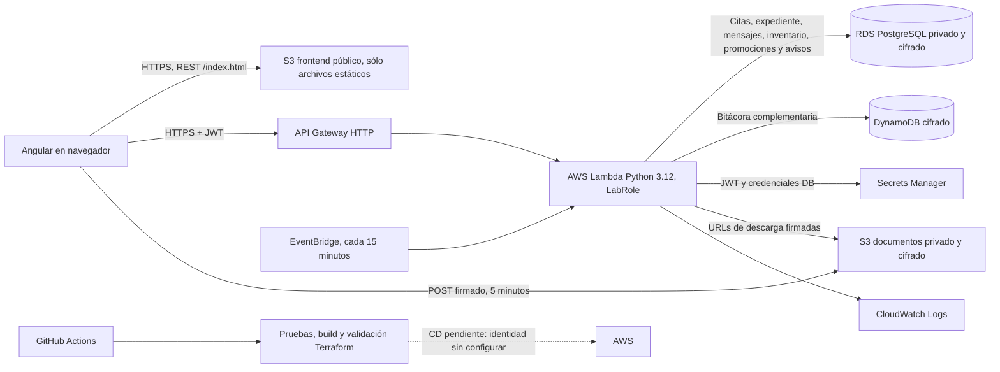

# Arquitectura MiDoc · fase 2

## Componentes y persistencia

| Servicio | Función y estado |
| --- | --- |
| Lambda | Ejecuta API Python 3.12 dentro de la VPC; se invoca mediante API Gateway y usa el rol existente `LabRole`. |
| API Gateway HTTP | Expone las rutas HTTPS y reenvía las solicitudes a Lambda. |
| RDS PostgreSQL | Base transaccional de usuarios, citas, agenda, expediente, consentimiento, consultas, recetas, mensajes, inventario, promociones, suscripciones y avisos. RDS es privado y cifrado; Lambda es el único origen de TCP 5432. |
| Secrets Manager | Guarda `jwt_secret` y el secreto administrado por RDS; la función los lee usando el endpoint privado. |
| S3 frontend | Archivos estáticos públicos de lectura. Se utiliza el endpoint REST HTTPS /index.html, probado desde Edge sin necesitar CloudFront. |
| S3 documentos | Bucket separado, privado, cifrado con AES-256 y con bloqueo de acceso público. Lambda crea formularios POST y URLs GET firmadas por 300 segundos. |
| DynamoDB | Bitácora complementaria de lectura de expedientes: `pk=PACIENTE#<id>` y `sk=ACCESO#<fecha>#<uuid>`. RDS conserva también la bitácora y los datos transaccionales. |
| IAM | No se crean políticas ni roles; Lambda ejecuta con el `LabRole` que ya proporciona AWS Academy. |
| CloudWatch Logs | Registros de Lambda. Las cinco métricas de negocio, dos alertas y dashboard quedan para la fase final. |

Lambda usa endpoints VPC privados para Secrets Manager y endpoints Gateway para S3 y DynamoDB. Así, la función dentro de la VPC no necesita NAT para estos servicios. El acceso a RDS queda limitado al security group de Lambda. El frontend estático usa HTTPS mediante S3 REST. Se mantienen datos ficticios por tratarse de una demostración académica.

## Flujos y control de acceso

1. **Búsqueda y agenda:** el cliente consulta perfiles, promociones y horarios; sólo un paciente puede crear una cita. Participantes pueden cancelar/reprogramar; el profesional puede confirmar. El índice único de PostgreSQL evita doble reserva. EventBridge genera recordatorios para las siguientes 24 horas cada 15 minutos sin depender de la bandeja.
2. **Expediente y consentimiento:** el paciente consulta y actualiza su expediente y concede o revoca acceso. El backend verifica rol, vigencia de suscripción y consentimiento antes de devolver datos o enlaces de documentos. Cada lectura profesional se registra en RDS y DynamoDB. Los documentos se cargan directamente a S3 con un POST firmado de cinco minutos.
3. **Suscripción y consulta:** el pago de demostración habilita el panel; el profesional administra horario, inventario, promociones y pacientes autorizados. La consulta completa la cita y guarda diagnóstico, tratamiento y receta en una transacción PostgreSQL. El paciente recupera su receta y puede imprimirla/guardarla como PDF desde el navegador. La mensajería requiere cita o consentimiento y genera avisos internos.

La suscripción es una simulación; no se envían datos de tarjetas a una pasarela ni se realizan cargos. No cargues documentos clínicos reales: este MVP de clase no incluye análisis antivirus, retención regulatoria ni controles operativos de producción.

## Decisiones y limitaciones de la cuenta

- Tarea 2 prioriza PostgreSQL por relaciones, restricciones y transacciones; DynamoDB se usa sólo para la bitácora propuesta como extensión. No hay datos de negocio duplicados en DynamoDB.
- Cognito se excluyó porque la cuenta de AWS Academy no permite configurar los User Pools requeridos. Se usa JWT propio; su secreto y las credenciales DB van en Secrets Manager.
- Las consultas `cloudfront:ListDistributions`, `cloudfront:GetDistribution` y lectura de políticas IAM resultaron denegadas. Se eligió S3 REST HTTPS para el frontend. No se comprobó que la creación de CloudFront esté prohibida.
- El endpoint de S3 website es público sólo para `GetObject` del bucket de frontend. El bucket de documentos está separado y bloquea todo acceso público.
- El pago sigue simulado. Las consultas SES probadas fueron denegadas; el permiso de envío no fue evaluado. No hay email/push; los avisos se generan automáticamente y se consultan al abrir MiDoc. Se mantiene la bandeja interna PostgreSQL y no se reutiliza el topic `RedshiftSNS`.
- EventBridge ejecuta Lambda cada 15 minutos mediante permiso del recurso limitado a la regla. Se observó una invocación automática en CloudWatch. LabRole no se modifica.
- El workflow hace integración continua; el despliegue automático queda pendiente porque este proyecto no tiene una identidad de despliegue federada configurada y validada.
