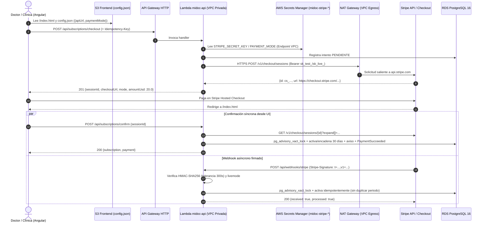

# Pasarela de Pagos Real con Stripe (Prueba/Sandbox y Producción)

**Requisitos cubiertos:** `R3`, `REQ-F1-06`, `REQ-F2-09`, `REQ-F3-09`.  
**Módulos responsables:** `backend/src/pagos_stripe.py`, `backend/src/flujos.py`, `backend/src/app.py`, `backend/migrations/004_stripe_suscripcion_y_perfil.sql`, `frontend/src/app/panel-doctor.component.*`, `infrastructure/variables.tf`, `infrastructure/main.tf`, `infrastructure/frontend_config.py`, `.github/workflows/cd.yml`.

---

## 1. Comparativa PayPal (Orders v2) vs. Stripe (Checkout Sessions + Webhook) y justificación

Para sustituir la simulación de suscripción de Fase 2 ($20.00 USD / 30 días para roles `DOCTOR` y `CLINICA`), se evaluaron **PayPal Orders v2** y **Stripe Checkout Sessions**. Se seleccionó **Stripe** por menor complejidad operativa, menor superficie de errores y cero dependencias binarias externas en AWS Lambda:

| Criterio técnico | PayPal (Orders v2) | Stripe (Checkout Sessions + Webhook) — **Elegido** | Ventaja para MiDoc |
| --- | --- | --- | --- |
| **Autenticación API** | OAuth2 (`POST /v1/oauth2/token` con `client_id` + `secret`), manejo de expiración y caché de `access_token` | Un solo encabezado `Authorization: Bearer <sk_test_\|sk_live_>` en `https://api.stripe.com/v1/*` | Elimina el paso previo de token OAuth2 y su rotación de expiración en frío en Lambda |
| **Flujo de cobro y captura** | Multipaso: crear orden -> aprobación de usuario -> llamada explícita `POST /v2/checkout/orders/{id}/capture` | Sesión hospedada PCI-compliant (`POST /v1/checkout/sessions`, `mode=payment`) + consulta única `GET /v1/checkout/sessions/{id}` | Stripe captura automáticamente el cargo en su página hospedada; menor estado intermedio |
| **Verificación de Webhook** | Validación mediante cadena de certificados X.509 (`PAYPAL-CERT-URL`, CRC32) o llamada extra a `/v1/notifications/verify-webhook-signature` | Firma HMAC-SHA256 directa sobre `t=...,v1=...` en `Stripe-Signature` con ventana anti-replay de 300 s | ~45 líneas de Python stdlib (`hmac`, `hashlib`), sin dependencias ni llamadas salientes extra |
| **Dependencias en Lambda** | Requiere SDK o gestión OAuth2 adicional | **Cero SDKs externos**: `backend/src/pagos_stripe.py` usa únicamente stdlib (`urllib.request`, `hmac`, `hashlib`, `json`, `re`) | `backend/requirements.txt` mantiene sólo `psycopg2-binary==2.9.9` |
| **Seguridad prueba vs. producción** | Distintos endpoints (`api-m.sandbox.paypal.com` vs `api-m.paypal.com`) sin prefijo estructural en la llave | Prefijos estructurales obligatorios `sk_test_...` vs `sk_live_...` + campo `livemode` en cada sesión/evento | Terraform, CI/CD (`cd.yml`) y backend validan que el prefijo coincida con `payment_mode` antes de desplegar o cobrar |
| **Idempotencia nativa** | Encabezado `PayPal-Request-Id` obligatorio en varios pasos | Encabezado estándar `Idempotency-Key` soportado directamente en `POST /v1/checkout/sessions` | Se propaga directamente desde la API de MiDoc (`_ejecutar_idempotente`) |

---

## 2. Arquitectura y flujo de punta a punta



### Controles clave implementados

1. **Retiro del pago simulado legado:** `POST /api/subscriptions/pay` fue deshabilitado y responde `410 Gone` (`backend/src/app.py:347-348`).
2. **Protección contra redirección abierta:** En producción (`NODE_ENV=production`), `pagos_stripe._validar_url_retorno` exige esquema `https` y coincidencia exacta de dominio (`netloc`) con `FRONTEND_BASE_URL` (`https://<frontend-bucket>.s3.<region>.amazonaws.com/index.html`). Las URLs por defecto usan `#/panel/suscripcion?stripe_status=success&session_id={CHECKOUT_SESSION_ID}` para funcionar sobre S3 REST `/index.html` con `HashLocationStrategy`.
3. **Concurrencia sin doble activación:** Si el usuario vuelve del navegador (`POST /api/subscriptions/confirm`) al mismo tiempo que Stripe entrega el webhook (`POST /api/webhooks/stripe`), `RepoPostgres.activar_suscripcion_stripe` (`backend/src/flujos.py:1581`) adquiere `SELECT pg_advisory_xact_lock(hashtext(doctor_id))` y valida el estado de `stripe_session_id` (`ux_suscripcion_stripe_session_id`), garantizando que una sesión pagada active **exactamente un periodo de 30 días** y emita la métrica `PaymentSucceeded` una sola vez.
4. **Salida a Internet desde VPC privada:** Como `midoc-api` reside en dos subredes privadas (`172.31.96.0/20` en `us-east-1a` y `172.31.112.0/20` en `us-east-1b`) para conectarse a RDS privado, Terraform (`infrastructure/main.tf`) aprovisiona `aws_eip.nat`, `aws_nat_gateway.this` (controlado por `enable_nat_gateway = true`) y ruta `0.0.0.0/0` para alcanzar `https://api.stripe.com/v1/*`, manteniendo VPC Endpoints privados para Secrets Manager, S3 y DynamoDB.
5. **Almacenamiento en Secrets Manager y rotación:**
   - El secreto de pagos se crea en **AWS Secrets Manager** mediante `aws_secretsmanager_secret.stripe` con `name_prefix = "${var.project_name}-stripe-"` y `recovery_window_in_days = 0`.
   - Almacena las claves JSON `payment_mode`, `stripe_secret_key`, `stripe_webhook_secret` y `price_amount_cents`.
   - A diferencia del secreto `jwt_secret`, `aws_secretsmanager_secret_version.stripe` **no** tiene `lifecycle { ignore_changes = [secret_string] }`, por lo que cambiar de `test` a `live` y ejecutar `terraform apply` actualiza de inmediato las credenciales vigentes en Secrets Manager y Lambda.
6. **Contrato `config.json` del frontend:** `infrastructure/frontend_config.py` y `publish_frontend.py` publican únicamente `{"apiUrl": "https://...", "paymentMode": "test" | "live"}` con `cache-control: no-cache`. No se expone ninguna llave publicable en `config.json` porque todo el formulario de tarjeta corre en Stripe Hosted Checkout.

---

## 3. Guía operativa: alternar entre Modo Prueba (`test`) y Producción (`live`) antes de desplegar

> **Advertencia crítica de seguridad:** **NUNCA** confirmes en Git llaves `sk_test_`, `sk_live_` ni `whsec_`. El archivo `infrastructure/terraform.tfvars` está ignorado en `.gitignore`; usa únicamente variables locales (`terraform.tfvars` / `TF_VAR_*`) o secretos cifrados del repositorio en GitHub (`gh secret set`).

### Validaciones automáticas antes del despliegue

Terraform (`infrastructure/variables.tf:84-128`) bloquea despliegues inconsistentes en tiempo de `plan`/`apply`:
- `payment_mode` sólo acepta `"test"` o `"live"`.
- Si `payment_mode = "test"`, cualquier `stripe_secret_key` no vacía debe comenzar con `sk_test_`.
- Si `payment_mode = "live"`, cualquier `stripe_secret_key` no vacía debe comenzar con `sk_live_`.
- Si `stripe_webhook_secret` no está vacío, debe comenzar con `whsec_`.
- Adicionalmente, `.github/workflows/cd.yml` (`preflight`) rechaza ejecuciones en `live` sin `TF_VAR_stripe_secret_key` (`sk_live_...`).

---

### Opción A — Despliegue local con Terraform

#### 1. Preparar credenciales Stripe según el entorno
- **Modo Prueba / Sandbox (uso en clase y validación):**
  - En el Dashboard de Stripe activa **Test mode**.
  - Obtén tu llave secreta de pruebas (`sk_test_...`).
  - (Opcional si probarás webhooks reales hacia API Gateway) Crea un endpoint de webhook apuntando a `https://<api-url>/api/webhooks/stripe` para eventos `checkout.session.completed`, `checkout.session.expired`, `payment_intent.payment_failed` y copia su `whsec_...`.
- **Modo Producción (`live`):**
  - Desactiva Test mode en Stripe (cuenta verificada con cobros reales habilitados).
  - Obtén tu llave secreta de producción (`sk_live_...`) y el secreto del webhook productivo (`whsec_...`).

#### 2. Configurar `infrastructure/terraform.tfvars` (o variables `TF_VAR_*`) antes de `terraform apply`

Para **Modo Prueba (`test`)**:
```hcl
# infrastructure/terraform.tfvars (ignorado por Git)
payment_mode              = "test"
stripe_secret_key         = "sk_test_REEMPLAZAR"
stripe_webhook_secret     = "whsec_REEMPLAZAR" # opcional si sólo se confirma vía retorno del Checkout
stripe_price_amount_cents = 2000               # $20.00 USD
enable_nat_gateway        = true
```

Para cambiar a **Producción (`live`)** antes de desplegar:
```hcl
# infrastructure/terraform.tfvars (ignorado por Git)
payment_mode              = "live"
stripe_secret_key         = "sk_live_REEMPLAZAR"
stripe_webhook_secret     = "whsec_REEMPLAZAR"
stripe_price_amount_cents = 2000
enable_nat_gateway        = true
allow_demo_seed           = false
```

*(Alternativa sin escribir llaves en disco: exporta `$env:TF_VAR_payment_mode="test"`, `$env:TF_VAR_stripe_secret_key="sk_test_..."`, `$env:TF_VAR_stripe_webhook_secret="whsec_..."` en la sesión de PowerShell.)*

#### 3. Aplicar infraestructura y sincronizar `config.json`
```powershell
npm run build --prefix frontend
terraform -chdir=infrastructure validate
terraform -chdir=infrastructure apply -var-file=terraform.tfvars
```
El propio `terraform apply` actualiza:
1. La variable de entorno `PAYMENT_MODE` en Lambda `midoc-api`.
2. El secreto en AWS Secrets Manager (`midoc-stripe-*`).
3. El archivo `config.json` en S3 (`{"apiUrl": "...", "paymentMode": "test" | "live"}`).

Si actualizas únicamente el frontend posteriormente, pasa explícitamente `--payment-mode`:
```powershell
python infrastructure/publish_frontend.py --payment-mode test   # o live
```

---

### Opción B — Despliegue automatizado con GitHub Actions (`.github/workflows/cd.yml`)

1. Configura los secretos en el repositorio usando GitHub CLI (`gh`):
   ```powershell
   # Para Sandbox (test):
   gh secret set TF_VAR_stripe_secret_key --body "sk_test_REEMPLAZAR"
   gh secret set TF_VAR_stripe_webhook_secret --body "whsec_REEMPLAZAR"

   # Para Producción (live) — actualizar antes de lanzar en modo live:
   gh secret set TF_VAR_stripe_secret_key --body "sk_live_REEMPLAZAR"
   gh secret set TF_VAR_stripe_webhook_secret --body "whsec_REEMPLAZAR"
   ```
2. Ejecuta el workflow `MiDoc CD` indicando el modo:
   ```powershell
   # Despliegue manual en modo prueba:
   gh workflow run cd.yml -f payment_mode=test -f enable_monitoring=true -f run_smoke=true

   # Despliegue manual en modo producción (requiere sk_live_ en TF_VAR_stripe_secret_key):
   gh workflow run cd.yml -f payment_mode=live -f enable_monitoring=true -f run_smoke=true
   ```
3. En `push` automático a `main`, `cd.yml` usa `payment_mode=test` por defecto y valida la consistencia del prefijo de `TF_VAR_stripe_secret_key` en el job `preflight` antes de ejecutar `terraform apply`.

---

## 4. Verificación en modo prueba

- **Pruebas unitarias offline de Stripe:**
  ```powershell
  python -m unittest discover -s backend/test -p "test_pagos_stripe.py" -v
  ```
  Verifica generación de URLs de retorno, validación `sk_test_`/`sk_live_`, bloqueo de open-redirect, verificación HMAC de `Stripe-Signature` (firma válida, inválida y expirada >300 s), manejo de errores `400`/`402`/`502`/`503` y desajuste de `livemode`.
- **Simulación local controlada (`STRIPE_API_BASE`):** En entornos locales (`NODE_ENV != "production"`), `pagos_stripe._resolver_api_base()` acepta `STRIPE_API_BASE` apuntando a un servidor mock (usado por `tests/e2e/run_e2e.py --mode live --target local --stripe-mode mock`). En producción (`NODE_ENV == "production"`), `STRIPE_API_BASE` queda fijo a `https://api.stripe.com/v1`.
- **Verificación en vivo en AWS (Sandbox):** En el panel de doctor/clínica (`/index.html#/panel/suscripcion`), el badge muestra **`Modo prueba (Stripe Sandbox)`** cuando `config.json` declara `"paymentMode": "test"` y **`Producción (Stripe Live)`** cuando declara `"live"`. Al pulsar el botón de suscripción, se redirige a `checkout.stripe.com`, se completa el pago de prueba y el retorno confirma y activa la suscripción de 30 días en RDS PostgreSQL.
