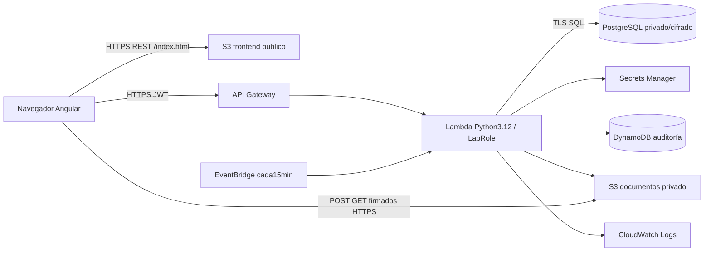

# MiDoc — Reporte técnico de fase dos

Fecha:16 de octubre de 2026. Entorno:AWS Academy Learner Lab, us-east-1. El documento de entrega de cuatro páginas es [ENTREGA-FASE2.pdf](ENTREGA-FASE2.pdf). El video permanece pendiente por instrucción del usuario. La matriz completa está en [REVISION-INTEGRAL.md](../docs/REVISION-INTEGRAL.md).

## Alcance y decisiones

Reporte 1 define pacientes, profesionales y centros médicos, búsqueda/citas, expediente consentido y suscripción/consulta/historial. Se integran sus ampliaciones de inventario, promociones, mensajes, recetas y avisos. Los centros médicos usan CLINICA conforme a Tarea2. El Proyecto Integrador exige para esta fase tres recorridos, mayoría del sistema en nube, scripts y evidencias.

RDS PostgreSQL conserva todas las entidades relacionales. Según la investigación de Tarea2, Cognito User Pools se sustituye por JWT y contraseñas scrypt; la llave y credenciales RDS se obtienen de Secrets Manager. Lambda conserva LabRole existente; no se crean roles/políticas IAM. DynamoDB sólo complementa la auditoría. Tarea2 no exige SES/SNS; correo no implementado.

## Arquitectura desplegada

Lambda usa VPC y endpoints SecretsManager/S3/DynamoDB; RDS acepta5432 desde su security group. S3 documentos bloquea acceso público y cifra AES256. Las URLs firmadas duran300segundos. El frontend usa endpoint REST HTTPS S3, sin requerir CloudFront; el endpoint website HTTP antiguo no se usa como enlace de entrega.

## Tres flujos y verificación

1. Búsqueda y agenda: registro, filtros, perfil/disponibilidad, reserva, confirmación, reprogramación y cancelación. Validación de roles, fechas, horarios y conflicto; nube y navegador comprobados.
2. Expediente y consentimiento: guardar expediente, otorgar/revocar, exigir suscripción y consentimiento, auditar acceso. S3 PDF sintético probado por API y DICOM con MIME genérico probado desde Edge HTTPS/CORS, incluyendo eliminación.
3. Suscripción y consulta: tarjetas demo aprobada/rechazada, vigencia30días, horario del profesional y cita real ya iniciada. Consulta con diagnóstico/tratamiento/notas, receta e historial persistidos en RDS. Consulta registrada y receta abierta también desde Edge. Repetición rechazada409; revocación bloquea acceso403.

Las operaciones de negocio y sus avisos comparten una transacción PostgreSQL: si falla la notificación se revierte la operación. Se probaron fallos inducidos localmente y commit/rollback del adaptador; no se indujeron fallos de infraestructura AWS. EventBridge genera recordatorios y vencimientos sin navegador, con deduplicación; su ejecución automática fue observada en CloudWatch.

## Evidencia

- 36 pruebas de backend aprobadas; build Angular con Node24 y fmt/validate Terraform aprobados.
- [43 peticiones verificadas más consulta/receta desde navegador](../docs/evidencia-aws-e2e.json).
- [Seis recorridos de interfaz y ocho vistas axe sin infracciones detectadas](../docs/evidencia-browser.json); sin erroresJS, anchos320/390px, salto por teclado y formularios etiquetados. No equivale a certificaciónWCAG manual.
- [Invocación automática EventBridge](../docs/evidencia-recordatorios.json), con cadencia original15min restaurada.
- RDS16.13 privado/cifrado; Lambda3.12 Active/Successful con LabRole. DynamoDB Query confirmó eventos del paciente sintético.

Frontend: https://midoc-frontend-647018795197.s3.us-east-1.amazonaws.com/index.html

API: https://4otc5sejki.execute-api.us-east-1.amazonaws.com

Los scripts smoke son explícitos y reproducibles en backend/test. Crean cuentas E2E DEMO; archivos, insumos y promociones se eliminan, el horario sintético se vacía y se revoca consentimiento al terminar. Historial/cuentas/mensajes sintéticos permanecen. No se exponen JWT, secretos o datos clínicos reales.

## Pendientes y límites

El pago es una simulación y las promociones no canjean/cobran automáticamente. No hay email/push ni identidad remitente/suscripción confirmada; las denegaciones SES/CloudFront observadas sólo acreditan las consultas concretas, no una prohibición global. Los avisos programados se consultan al abrir MiDoc.

Faltan migraciones versionadas y separación de credenciales de aplicación, idempotencia de cliente frente a pérdida de respuesta, restore/carga/concurrencia, TLS PostgreSQL verify-full, políticas de cuentas demo, antimalware/retención y auditoría manual con lector de pantalla. No es una aplicación aprobada para uso clínico real. La disponibilidad depende de sesión/presupuesto LearnerLab; recursos permanecen activos.

CI prueba/compila/valida; no se ejecutó remotamente porque no se hizo push. CD y monitoreo final (cinco métricas, dos alarmas, dashboard) se mantienen para los hitos siguientes del Proyecto Integrador. Los cambios locales están desplegados pero pendientes de commit/push. El video sigue pendiente; no se declara entrega académica completa.

## Equipo

Emmanuel Pulido Tinajero:DevOps e infraestructura; David (Dakewer):frontend; Gilberto Anaya:backend. El historial Git contiene participación de los tres integrantes; la evidencia nueva debe publicarse en el repositorio.
